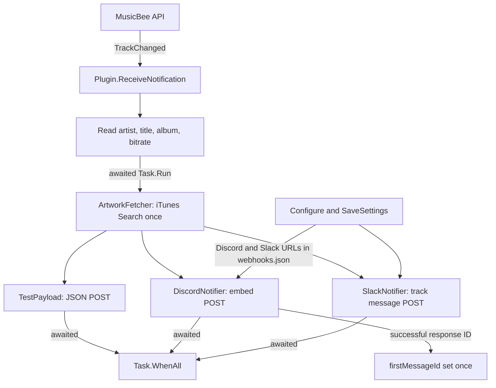

# Developer Changelog and Engineering History

This document follows the repository's Git history and the implementation present at the reviewed checkout. It is an engineering record, not a claim that every integration has been exercised against a live MusicBee installation or service.

## Contents

- [History scope and branch map](#history-scope-and-branch-map)
- [2026-10-08 — Project and plugin foundation](#2026-10-08--project-and-plugin-foundation)
- [2026-10-11–12 — Discord payload and track notifications](#2026-10-1112--discord-payload-and-track-notifications)
- [2026-10-12 — Project organization and artwork lookup](#2026-10-12--project-organization-and-artwork-lookup)
- [2026-10-12–13 — Async work, Discord responses, and local delivery](#2026-10-1213--async-work-discord-responses-and-local-delivery)
- [2026-10-13 — Slack prototype](#2026-10-13--slack-prototype)
- [2026-10-14–16 — Webhook settings, Slack messages, and parallel delivery](#2026-10-1416--webhook-settings-slack-messages-and-parallel-delivery)
- [Current architecture](#current-architecture)
- [Current status and follow-up](#current-status-and-follow-up)

## History scope and branch map

The history was reviewed across the two local product branches. `main` points to `3d3f57b`; the checked-out `perf/webhook-pipeline` is based on that commit and adds five product commits, ending at `b1024ee`. The branch-specific changes are summarized below. Agent/session checkpoint commits are not treated as feature milestones. Commit dates below come from Git metadata; the repository history does not establish release tags or evidence of a published version.

Earlier sections record the history through the Slack prototype. The later `main` commits and `perf/webhook-pipeline` work are covered in the next section; the architecture and status sections describe the checked-out `b1024ee` source.

## 2026-10-08 — Project and plugin foundation

### What changed

The repository began as a .NET Framework 4.8 class-library project for a MusicBee plugin. Initial commits established the solution and project configuration, assembly metadata, the MusicBee API interface, editor/build settings, and an initial HTTP client. The first plugin implementation was then pared back: commit `7f57451` removed that early `WebhookClient` and reduced the original plugin file, before the later plugin implementation was added.

### Why it changed

The commit messages document setup and early cleanup, but do not record a detailed design rationale. The sequence shows an initial scaffold being simplified before the plugin's MusicBee-specific lifecycle and notification handling were implemented.

### How it works

The project targets `net48` and compiles against the MusicBee API interface and Windows Forms. The eventual plugin implementation is split across partial `Plugin` files, with initialization, settings, and notification handling in separate files. This is an outbound-notification plugin: it receives MusicBee events and sends HTTP requests; it is not an HTTP server.

### Engineering lessons

An early HTTP client and project skeleton are infrastructure, not proof of a working integration. The follow-up removal is a useful reminder to distinguish an exploratory implementation from the later code path that actually gets called by the host.

**Important commits**

- `8f35dd1` — Add initial configuration files for project setup
- `df8f9dd` — Add initial implementation of the webhook plugin for MusicBee
- `f524e22` — Add initial project files for mb_webhook plugin
- `8c6e008` — Refactor WebhookClient to improve SendAsync method and add necessary using directives
- `7f57451` — Remove WebhookClient class and update plugin description; add .gitkeep file for webhook directory
- `3fd3a6d` — Add implementation of MusicBee webhook plugin with configuration and notification handling

## 2026-10-11–12 — Discord payload and track notifications

### What changed

Discord delivery evolved from an inline POST toward a typed payload and embed model. The implementation added serialized JSON, a Discord embed with track title and artist, then additional presentation fields including album, bitrate, source footer, color, and artwork thumbnail. The track-change path reads MusicBee metadata and passes it to the notifier. A separate JSON payload model was also expanded with artist, title, album, bitrate, and art fields.

### Why it changed

Commit messages describe improving payload structure and adding richer track information. The history demonstrates an iterative move from a basic webhook request to a provider-specific, more structured Discord message; it does not establish that every intermediate payload format was deployed.

### How it works

`DiscordNotifier` serializes model objects with Newtonsoft.Json and posts `application/json` through a static `HttpClient`. `DiscordEmbeded` and its related model classes describe the webhook body. The current embed contains title, artist description, album and bitrate fields, a footer, and an artwork thumbnail. Album falls back to `"Unknown"` when blank. Discord delivery is synchronous from the caller's perspective: the code blocks on `PostAsync` and response-body reading with `GetAwaiter().GetResult()`.

### Engineering lessons

Typed payload models make the shape of an external API request easier to read and modify than assembling JSON ad hoc. They do not, by themselves, validate the request against Discord's schema or prove that Discord accepted it. Adding metadata also means the caller, model, and JSON serializer must remain aligned.

**Important commits**

- `6fb70dc` — Refactor SendMessage method in DiscordNotifier to use JsonSerializer for track state and update webhook call in Plugin class
- `7cfe6d9` — Fix content variable declaration in SendMessage method to correctly create StringContent for webhook call
- `d9fc48f` — Add Newtonsoft.Json reference to project dependencies
- `4f6c4c0` — Refactor SendMessage method to use DiscordPay class for payload serialization
- `5387849` — Refactor SendMessage method to update payload structure and include embeds for Discord message
- `622baaa` — Add footer to Discord message embed with source information
- `d312e89` — Add thumbnail support to DiscordEmbed and update message formatting
- `7a5dc66` — Add bitrate information to webhook payload for enhanced media details
- `135a738` — Add bitrate parameter to SendMessage and update Discord embed with bitrate information
- `3fd3a6d` — Add implementation of MusicBee webhook plugin with configuration and notification handling

## 2026-10-12 — Project organization and artwork lookup

### What changed

The plugin and provider code were reorganized under `webhook/`, with Discord notifier and model files collected under `webhook/Apps/discord/`. The separate `feature-discord` line added artwork lookup and the artwork-bearing notification flow; it was merged into the main line by `890ea6c`. The lookup was refined to use artist, title, and eventually album as search terms. On the local `main` ref, `c4a406c` renamed `Fetcher.cs` to `Itunes_Helper.cs` without changing its contents; the checked-out project includes the renamed file.

### Why it changed

The refactor commit messages state that the goal was to organize files and improve consistency. Artwork commits describe improving retrieval and search. Beyond those recorded messages, the history does not establish specific performance or matching-quality measurements.

### How it works

`ArtworkFetcher.GetArtworkUrl` builds an iTunes Search API URL with `Uri.EscapeDataString(artist + " " + title + " " + album)`, requests one song result, parses `results[0].artworkUrl100` with Newtonsoft.Json, and returns that URL. Lookup exceptions are logged and produce `null`; no matching result can also yield `null`. The fetch itself uses `GetStringAsync(...).GetAwaiter().GetResult()`, so it blocks its calling thread.

The project layout is explicit in `whook_plugin.csproj`, which includes the Discord, Slack, artwork, settings, and notification source files. The rename to `Itunes_Helper.cs` is organizational; the current helper's class remains named `ArtworkFetcher`.

### Engineering lessons

Adding album to a search query supplies another matching signal, but selecting only the first result (`limit=1`) still leaves matching quality dependent on the search service. Returning `null` on a failed lookup lets callers continue without art, but callers and presentation models must tolerate that absent value.

**Important commits**

- `213cc2d` — refactor: file structers in a single webhook directory
- `a1faf0c` — refactor: reorganize whook_plugin.cs and related files into webhook directory
- `ef79fe8` — refactor: reorganize Discord models and notifier into a single directory
- `790c5c3` — feat: initial implemation for artwork url getter
- `d24e02d` — feat: add SearchTerm class and update BuildingSearchUrl method in ArtworkFetcher
- `3df5576` — feat: update ArtworkFetcher to improve artwork URL retrieval and add error handling
- `629938b` — feat: enhance ReceiveNotification to include artwork URL handling and logging for Discord notifications
- `6842975` — feat: update GetArtworkUrl method to include album parameter for improved artwork retrieval
- `890ea6c` — Merge branch 'feature-discord' after the with standard look and first full implemation
- `c4a406c` — feat: replace Fetcher.cs with Itunes_Helper.cs for improved artwork retrieval functionality

## 2026-10-12–13 — Async work, Discord responses, and local delivery

### What changed

The notification and HTTP code acquired `async`/`Task` signatures, and the track-change handler began launching part of its work on a background task. Discord delivery was changed to inspect the HTTP response, log a non-success status, return a message ID from a successful response, and retain the first non-null ID in `Plugin.firstMessageId`. A five-second timeout was added to the Discord `HttpClient`. Names were clarified to `DiscordWebhookUrl`; the earlier shared `webhookUrl` value had become Discord-specific as another destination was introduced.

### Why it changed

Commit messages cite asynchronous handling, performance, message-ID handling, and error logging. The code shows those changes were incremental rather than a full async conversion: only some request paths are awaited end-to-end.

### How it works

At this stage of the history, on a track change `ReceiveNotification` read artist, title, album, and bitrate, then started an unawaited `Task.Run` body for artwork lookup, a JSON POST to a hard-coded localhost endpoint, and a Discord POST. It separately awaited the Slack call added later. Discord appended `wait=true` to its webhook URL, read the response body, logged non-success status codes, and parsed the JSON `id` on success. `firstMessageId` was assigned only while it was `null`; it was not used to edit or replace an earlier Discord message.

The localhost JSON route is implemented by `TestPayload.SendAsync`, whose payload properties are `Artist`, `Title`, `Album`, `Bitrate`, and `Art`. At that earlier snapshot, the method blocked on `PostAsync` despite its `async Task` signature and did not inspect the response status. The current implementation awaits the POST and checks the response status. The separate `WebhookClient.SendAsync` also awaits `PostAsync`, but the notification flow does not call it.

### Engineering lessons

`async` and `await` can keep a caller from blocking while I/O is in progress only when the asynchronous operation is actually awaited through the call chain. The earlier unawaited `Task.Run` was fire-and-forget, so its completion and exceptions were not coordinated with MusicBee's callback. Later commits coordinate the sends and share artwork, although the Discord HTTP path still blocks internally. The commit messages use “asynchronous” and “performance,” but the current implementation does not demonstrate a fully non-blocking or measured improvement.

**Important commits**

- `1972d95` — feat: update SendAsync method to be asynchronous for improved performance
- `13f655b` — feat: update asynchronous handling in ReceiveNotification for improved performance
- `2496467` — feat: update SendMessage method to return Discord message ID and improve error logging
- `dd50544` — feat: enhance ReceiveNotification to log Discord message ID and manage firstMessageId
- `e47edb0` — feat: initialize HttpClient with timeout and add synchronization for message ID handling
- `b472c37` — refactor: comment out unused synchronization and message ID variables, update payload to use DiscordEmbeded
- `c2c3f49` — refactor: rename webhookUrl to DiscordWebhookUrl for consistency across the codebase

## 2026-10-13 — Slack prototype

### What changed

Slack support was added as another notifier, including a `SlackWebhookUrl` field and a call from the track-change handler. `ReceiveNotification` became `async` so it could await the Slack send.

### Why it changed

The commits document adding Slack integration. They do not record a completed configuration experience or a final track-specific message format.

### How it works

At this point in the history, `SlackNotifier.SendAsync` serialized a `SlackLocal` object and posted it as JSON using a `HttpClient` with a five-second timeout. That prototype used fixed placeholder values (`NowPlaying = "Hii"` and `Hello = "4000 port"`), received only the Slack URL, and did not check the response status. The following section records the later replacement with track-specific content and persisted settings.

### Engineering lessons

Adding a destination requires more than creating its HTTP client: the event data, configuration path, payload contract, response handling, and delivery semantics must all be connected. Here the transport path exists, but the content and configuration remain prototype-level. This assessment is based on the checked-in code, not a claim about the original intent.

**Important commits**

- `b21227a` — feat: add Slack integration by including slack.cs in the project
- `25da5cf` — feat: make ReceiveNotification method asynchronous and send notification to Slack
- `3c9f4b2` — feat: add SlackWebhookUrl for Slack integration
- `8f9b25b` — feat: implement SlackNotifier class for sending notifications to Slack

## 2026-10-14–16 — Webhook settings, Slack messages, and parallel delivery

### `main`: provider payloads and configurable destinations

The `main` line extended the Slack prototype with track-specific structured messages and dedicated Discord/Slack payload models. The Slack message gained title, artist, album, bitrate, and optional album artwork; both provider senders gained response/error logging. Configuration was expanded to edit both webhook URLs and save/load them together from `webhook/webhooks.json` in MusicBee's persistent storage.

The configuration and richer Slack payload replace the earlier prototype state described above: Slack no longer sends fixed placeholder text, and the settings form is now opened by the plugin's configuration entry point. These changes are present in `main` and inherited by `perf/webhook-pipeline`.

**Important commits**

- `dd20c70` — Add Slack webhook integration
- `c7f4460` — Improve Discord response parsing and error logging
- `9066fb0` — Add Slack response and error handling
- `1148851` — Add track details and artwork to Slack notifications
- `cdb5220` — Add structured Slack message and block models
- `acfd3c2` — Save user-provided Discord and Slack webhook URLs
- `9e7b76d` — Add the webhook configuration panel
- `587f03f` — Store webhook settings as JSON
- `71551f6` — Format Slack notifications with attachments and blocks
- `3d3f57b` — Include album information in Slack messages

### `perf/webhook-pipeline`: shared artwork and awaited concurrent sends

Five commits on `perf/webhook-pipeline` refine track-change delivery. Artwork is looked up once and reused for all destinations. The Discord send method and its caller were converted to Task-based delivery and awaited, and local, Discord, and Slack sends are started together and awaited with `Task.WhenAll`. The notification handler adds logging wrappers around send exceptions and retains the first returned Discord message ID.

These changes coordinate completion and avoid repeating the artwork request; they do not make every HTTP path fully non-blocking. In particular, the Discord notifier still synchronously waits on HTTP operations internally.

**Commits**

- `4ca87f2` — Resolve artwork once per track change
- `f6a62d3` — Make the Discord send method asynchronous and clarify parameter naming
- `9753c1e` — Await the Discord send call
- `c00ce3c` — Run destination sends concurrently with `Task.WhenAll`
- `b1024ee` — Add send exception logging wrappers and streamline notification handling

## Current architecture

The following describes the checked-out `perf/webhook-pipeline` source at `b1024ee`, verified by source inspection:

`Plugin.Initialise` initializes the MusicBee API interface, loads Discord and Slack URLs from `webhooks.json` when present, sets the log-file path, and registers player and tag notifications. On track change, `ReceiveNotification` reads the metadata, looks up artwork once on a worker task, starts all three sends, and awaits their completion. Send wrappers log exceptions; Discord returns a message ID which is retained only if `firstMessageId` has not already been set. The startup branch reads play state but takes no substantive action.

The main responsibilities are:

- `webhook/WhookPlugin.cs` — shared partial `Plugin` fields and MusicBee plugin lifecycle members.
- `webhook/PluginIntialize.cs` — MusicBee API initialization, persisted Discord and Slack URL loading, logging setup, and notification registration.
- `webhook/PlaybackEvents.cs` — startup/track-change dispatch, metadata reads, artwork lookup, and coordinated notification sends.
- `webhook/PanelConfiguration.cs` and `webhook/settingsPanel.cs` — Discord/Slack URL configuration UI; `SaveSettings` persists both values in MusicBee's persistent storage.
- `webhook/ArtworkRetriver/Itunes_Helper.cs` — `ArtworkFetcher`, which queries iTunes and returns an artwork URL.
- `webhook/Apps/discord/discord.cs` and `webhook/Apps/discord/DiscordModels/DiscordModels.cs` — Discord serialization, HTTP delivery, and embed data types.
- `webhook/Apps/slack/slack.cs` and `webhook/Apps/slack/SlackModels/SlackModels.cs` — structured Slack payload construction and HTTP POST.
- `webhook/WebhookClient.cs` — a generic JSON POST helper; it is instantiated during initialization but is not used by the current notification flow.
- `Logger.cs` — timestamped, lock-protected append-to-file logging.

The project targets .NET Framework 4.8 and references Newtonsoft.Json, Fody, and Costura.Fody. A `MusicBee.local.targets` import supports a local plugin-copy build target, so local build configuration may be needed to build without that target reporting a missing plugin directory.

## Current status and follow-up

### Implemented and verified by source inspection

- MusicBee plugin initialization and registration for player/tag notifications.
- Reading artist, title, album, and bitrate on track changes.
- Discord embed construction, webhook POST, success-status check, response-ID parsing, and first-ID retention.
- Slack track message construction with optional artwork and HTTP response/error logging.
- iTunes Search API artwork lookup using artist, title, and album.
- JSON POST paths for the local endpoint and provider webhooks; sends are awaited together.
- Discord and Slack URL settings persistence and file logging.

“Verified” here means the behavior is present in the checked-in source. It does not mean the plugin has been exercised in MusicBee or that the remote services accepted requests.

### Implemented but not fully tested

- End-to-end MusicBee event delivery and plugin lifecycle.
- Discord and Slack delivery against live incoming webhooks.
- Artwork matching and rendering for missing or ambiguous metadata.
- The local JSON endpoint, whose server implementation and successful receipt are not present in this repository.

The file `tests/test_post_hook.cs` defines the `TestPayload` sender, but it has no visible test framework, assertions, or automated test cases; the project includes it as a source file. No runtime or integration test result is established by the Git history reviewed here.

### Known issues and technical debt visible in the current source

- The local POST URL remains hard-coded. `TestPayload.SendAsync` checks response status but its `HttpClient` has no explicit timeout configured.
- The Discord notifier's async method still uses synchronous waits for the HTTP POST and response-body read, so awaiting it does not make that path fully non-blocking.
- Artwork retrieval is synchronous internally and is run on a worker task; a lookup failure is logged and sends continue with no artwork.
- The Discord and Slack URL settings are persisted, but the local endpoint has no corresponding setting. The provider URLs must be configured for a fresh storage directory.
- The generic `WebhookClient` is instantiated but not used by the current notification flow.
- `firstMessageId` is only assigned once and never used to update a message. The synchronization variables visible in history are commented out in the current notifier.
- `Logger.Log` silently returns when no path is configured and suppresses file-write failures, limiting visibility into logging failures.
- The existing `README.md` describes a service that receives incoming webhooks, which does not match the outbound MusicBee plugin implemented in source.

### Planned features

No explicit future-work list or committed plan was found in the reviewed project documentation or source. Planned work is therefore **unknown**.

### Potential improvements (suggestions, not recorded plans)

- Convert the Discord HTTP operations to genuinely asynchronous calls and decide explicitly how MusicBee's notification callback should coordinate or schedule delivery.
- Make the local endpoint configurable and apply explicit timeout/cancellation handling consistently to every HTTP path.
- Add automated tests for payload shape, response/error handling, artwork parsing, and settings persistence; add an integration test only where an appropriate local or test service is available.
- Align the README with the plugin's actual outbound behavior.
