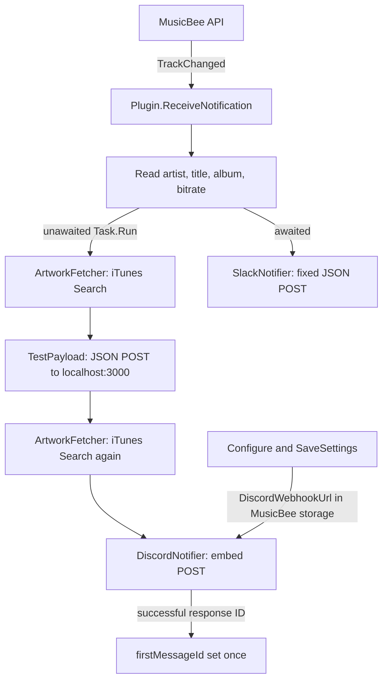

# Developer Changelog and Engineering History

This document follows the repository's Git history and the implementation present at the reviewed checkout. It is an engineering record, not a claim that every integration has been exercised against a live MusicBee installation or service.

## Contents

- [History scope and branch map](#history-scope-and-branch-map)
- [2026-10-08 — Project and plugin foundation](#2026-10-08--project-and-plugin-foundation)
- [2026-10-11–12 — Discord payload and track notifications](#2026-10-1112--discord-payload-and-track-notifications)
- [2026-10-12 — Project organization and artwork lookup](#2026-10-12--project-organization-and-artwork-lookup)
- [2026-10-12–13 — Async work, Discord responses, and local delivery](#2026-10-1213--async-work-discord-responses-and-local-delivery)
- [2026-10-13 — Slack prototype](#2026-10-13--slack-prototype)
- [Current architecture](#current-architecture)
- [Current status and follow-up](#current-status-and-follow-up)

## History scope and branch map

The history was reviewed across the available branches and refs. The checked-out `patch-work` branch and `origin/main` point to `8f9b25b` (the latest product commit covered here). The local `main` ref points to `c4a406c`, an ancestor of that checkout; it is 14 commits behind. `origin/feature-discord` points to `6842975` and its work is reachable from `origin/main` through merge commit `890ea6c`. The feature branch is therefore described as part of the merged product history, not as a separate current implementation.

Some refs are named for agent/session checkpoints rather than product branches. Those checkpoint commits are not treated as feature milestones. Commit dates below come from Git metadata. The repository history does not establish release tags or evidence of a published version; the former changelog's `0.1.0` heading should not be read as a verified release.

## 2026-10-08 — Project and plugin foundation

### What changed

The repository began as a .NET Framework 4.8 class-library project for a MusicBee plugin. Initial commits established the solution and project configuration, assembly metadata, the MusicBee API interface, editor/build settings, and an initial HTTP client. The first plugin implementation was then pared back: commit `7f57451` removed that early `WebhookClient` and reduced the original plugin file, before the later plugin implementation was added.

### Why it changed

The commit messages document setup and early cleanup, but do not record a detailed design rationale. The sequence shows an initial scaffold being simplified before the plugin's MusicBee-specific lifecycle and notification handling were implemented.

### How it works

The project targets `net48` and compiles against the MusicBee API interface and Windows Forms. The eventual plugin implementation is split across partial `Plugin` files, with initialization, settings, and notification handling in separate files. This is an outbound-notification plugin: it receives MusicBee events and sends HTTP requests; it is not an HTTP server.

### Engineering lessons

An early HTTP client and project skeleton are infrastructure, not proof of a working integration. The follow-up removal is a useful reminder to distinguish an exploratory implementation from the later code path that actually gets called by the host.

**Important commits**

- `8f35dd1` — Add initial configuration files for project setup
- `df8f9dd` — Add initial implementation of the webhook plugin for MusicBee
- `f524e22` — Add initial project files for mb_webhook plugin
- `8c6e008` — Refactor WebhookClient to improve SendAsync method and add necessary using directives
- `7f57451` — Remove WebhookClient class and update plugin description; add .gitkeep file for webhook directory
- `3fd3a6d` — Add implementation of MusicBee webhook plugin with configuration and notification handling

## 2026-10-11–12 — Discord payload and track notifications

### What changed

Discord delivery evolved from an inline POST toward a typed payload and embed model. The implementation added serialized JSON, a Discord embed with track title and artist, then additional presentation fields including album, bitrate, source footer, color, and artwork thumbnail. The track-change path reads MusicBee metadata and passes it to the notifier. A separate JSON payload model was also expanded with artist, title, album, bitrate, and art fields.

### Why it changed

Commit messages describe improving payload structure and adding richer track information. The history demonstrates an iterative move from a basic webhook request to a provider-specific, more structured Discord message; it does not establish that every intermediate payload format was deployed.

### How it works

`DiscordNotifier` serializes model objects with Newtonsoft.Json and posts `application/json` through a static `HttpClient`. `DiscordEmbeded` and its related model classes describe the webhook body. The current embed contains title, artist description, album and bitrate fields, a footer, and an artwork thumbnail. Album falls back to `"Unknown"` when blank. Discord delivery is synchronous from the caller's perspective: the code blocks on `PostAsync` and response-body reading with `GetAwaiter().GetResult()`.

### Engineering lessons

Typed payload models make the shape of an external API request easier to read and modify than assembling JSON ad hoc. They do not, by themselves, validate the request against Discord's schema or prove that Discord accepted it. Adding metadata also means the caller, model, and JSON serializer must remain aligned.

**Important commits**

- `6fb70dc` — Refactor SendMessage method in DiscordNotifier to use JsonSerializer for track state and update webhook call in Plugin class
- `7cfe6d9` — Fix content variable declaration in SendMessage method to correctly create StringContent for webhook call
- `d9fc48f` — Add Newtonsoft.Json reference to project dependencies
- `4f6c4c0` — Refactor SendMessage method to use DiscordPay class for payload serialization
- `5387849` — Refactor SendMessage method to update payload structure and include embeds for Discord message
- `622baaa` — Add footer to Discord message embed with source information
- `d312e89` — Add thumbnail support to DiscordEmbed and update message formatting
- `7a5dc66` — Add bitrate information to webhook payload for enhanced media details
- `135a738` — Add bitrate parameter to SendMessage and update Discord embed with bitrate information
- `3fd3a6d` — Add implementation of MusicBee webhook plugin with configuration and notification handling

## 2026-10-12 — Project organization and artwork lookup

### What changed

The plugin and provider code were reorganized under `webhook/`, with Discord notifier and model files collected under `webhook/Apps/discord/`. The separate `feature-discord` line added artwork lookup and the artwork-bearing notification flow; it was merged into the main line by `890ea6c`. The lookup was refined to use artist, title, and eventually album as search terms. On the local `main` ref, `c4a406c` renamed `Fetcher.cs` to `Itunes_Helper.cs` without changing its contents; the checked-out project includes the renamed file.

### Why it changed

The refactor commit messages state that the goal was to organize files and improve consistency. Artwork commits describe improving retrieval and search. Beyond those recorded messages, the history does not establish specific performance or matching-quality measurements.

### How it works

`ArtworkFetcher.GetArtworkUrl` builds an iTunes Search API URL with `Uri.EscapeDataString(artist + " " + title + " " + album)`, requests one song result, parses `results[0].artworkUrl100` with Newtonsoft.Json, and returns that URL. Lookup exceptions are logged and produce `null`; no matching result can also yield `null`. The fetch itself uses `GetStringAsync(...).GetAwaiter().GetResult()`, so it blocks its calling thread.

The project layout is explicit in `whook_plugin.csproj`, which includes the Discord, Slack, artwork, settings, and notification source files. The rename to `Itunes_Helper.cs` is organizational; the current helper's class remains named `ArtworkFetcher`.

### Engineering lessons

Adding album to a search query supplies another matching signal, but selecting only the first result (`limit=1`) still leaves matching quality dependent on the search service. Returning `null` on a failed lookup lets callers continue without art, but callers and presentation models must tolerate that absent value.

**Important commits**

- `213cc2d` — refactor: file structers in a single webhook directory
- `a1faf0c` — refactor: reorganize whook_plugin.cs and related files into webhook directory
- `ef79fe8` — refactor: reorganize Discord models and notifier into a single directory
- `790c5c3` — feat: initial implemation for artwork url getter
- `d24e02d` — feat: add SearchTerm class and update BuildingSearchUrl method in ArtworkFetcher
- `3df5576` — feat: update ArtworkFetcher to improve artwork URL retrieval and add error handling
- `629938b` — feat: enhance ReceiveNotification to include artwork URL handling and logging for Discord notifications
- `6842975` — feat: update GetArtworkUrl method to include album parameter for improved artwork retrieval
- `890ea6c` — Merge branch 'feature-discord' after the with standard look and first full implemation
- `c4a406c` — feat: replace Fetcher.cs with Itunes_Helper.cs for improved artwork retrieval functionality

## 2026-10-12–13 — Async work, Discord responses, and local delivery

### What changed

The notification and HTTP code acquired `async`/`Task` signatures, and the track-change handler began launching part of its work on a background task. Discord delivery was changed to inspect the HTTP response, log a non-success status, return a message ID from a successful response, and retain the first non-null ID in `Plugin.firstMessageId`. A five-second timeout was added to the Discord `HttpClient`. Names were clarified to `DiscordWebhookUrl`; the earlier shared `webhookUrl` value had become Discord-specific as another destination was introduced.

### Why it changed

Commit messages cite asynchronous handling, performance, message-ID handling, and error logging. The code shows those changes were incremental rather than a full async conversion: only some request paths are awaited end-to-end.

### How it works

On a track change, `ReceiveNotification` reads artist, title, album, and bitrate. It starts a `Task.Run` body for artwork lookup, a JSON POST to a hard-coded localhost endpoint, and a Discord POST; it does not await or retain that task. It separately awaits the Slack call added later. Discord appends `wait=true` to its webhook URL, reads the response body, logs non-success status codes, and parses the JSON `id` on success. `firstMessageId` is assigned only while it is `null`; the current source does not use it to edit or replace an earlier Discord message.

The localhost JSON route is implemented by `TestPayload.SendAsync`, whose payload properties are `Artist`, `Title`, `Album`, `Bitrate`, and `Art`. Despite its `async Task` signature, this method blocks on `PostAsync` rather than awaiting it, and it does not inspect the response status. The separate `WebhookClient.SendAsync` does await `PostAsync`, but the current notification flow does not call it.

### Engineering lessons

`async` and `await` can keep a caller from blocking while I/O is in progress only when the asynchronous operation is actually awaited through the call chain. A `Task.Run` that is neither awaited nor observed is fire-and-forget: its completion and exceptions are not coordinated with MusicBee's callback. Mixing that pattern with synchronous waits can make execution order and error reporting harder to reason about. The commit messages use “asynchronous” and “performance,” but the current implementation does not demonstrate a fully non-blocking or measured improvement.

**Important commits**

- `1972d95` — feat: update SendAsync method to be asynchronous for improved performance
- `13f655b` — feat: update asynchronous handling in ReceiveNotification for improved performance
- `2496467` — feat: update SendMessage method to return Discord message ID and improve error logging
- `dd50544` — feat: enhance ReceiveNotification to log Discord message ID and manage firstMessageId
- `e47edb0` — feat: initialize HttpClient with timeout and add synchronization for message ID handling
- `b472c37` — refactor: comment out unused synchronization and message ID variables, update payload to use DiscordEmbeded
- `c2c3f49` — refactor: rename webhookUrl to DiscordWebhookUrl for consistency across the codebase

## 2026-10-13 — Slack prototype

### What changed

Slack support was added as another notifier, including a `SlackWebhookUrl` field and a call from the track-change handler. `ReceiveNotification` became `async` so it could await the Slack send.

### Why it changed

The commits document adding Slack integration. They do not record a completed configuration experience or a final track-specific message format.

### How it works

`SlackNotifier.SendAsync` serializes a `SlackLocal` object and posts it as JSON using a `HttpClient` with a five-second timeout. In the current source, the object contains fixed placeholder values (`NowPlaying = "Hii"` and `Hello = "4000 port"`); it receives only the Slack URL, not the track metadata. The URL defaults to a localhost endpoint in the plugin class and is not loaded from or saved to the settings file. The response status is not checked.

### Engineering lessons

Adding a destination requires more than creating its HTTP client: the event data, configuration path, payload contract, response handling, and delivery semantics must all be connected. Here the transport path exists, but the content and configuration remain prototype-level. This assessment is based on the checked-in code, not a claim about the original intent.

**Important commits**

- `b21227a` — feat: add Slack integration by including slack.cs in the project
- `25da5cf` — feat: make ReceiveNotification method asynchronous and send notification to Slack
- `3c9f4b2` — feat: add SlackWebhookUrl for Slack integration
- `8f9b25b` — feat: implement SlackNotifier class for sending notifications to Slack

## Current architecture

The following describes the code at `8f9b25b`, verified by source inspection:

`Plugin.Initialise` initializes the MusicBee API interface, loads the Discord webhook URL from `webhookUrl.txt` if present, sets the log-file path, and registers player and tag notifications. `Plugin.ReceiveNotification` handles startup and track-change notifications; the startup branch currently reads play state but takes no substantive action. On track change, the two outbound paths are started as shown above. Artwork lookup is performed twice per track rather than shared.

The main responsibilities are:

- `webhook/WhookPlugin.cs` — shared partial `Plugin` fields and MusicBee plugin lifecycle members.
- `webhook/PluginIntialize.cs` — MusicBee API initialization, persisted Discord URL loading, logging setup, and notification registration.
- `webhook/ReceiveNotification.cs` — startup/track-change dispatch, metadata reads, and notification scheduling.
- `webhook/Configure.cs` and `webhook/SaveSettings.cs` — Discord URL UI and persistence in MusicBee's persistent storage.
- `webhook/ArtworkRetriver/Itunes_Helper.cs` — `ArtworkFetcher`, which queries iTunes and returns an artwork URL.
- `webhook/Apps/discord/discord.cs` and `webhook/Apps/discord/DiscordModels/Models.cs` — Discord serialization, HTTP delivery, and embed data types.
- `webhook/Apps/slack/slack.cs` — the Slack JSON payload and HTTP POST.
- `webhook/WebhookClient.cs` — a generic JSON POST helper; it is instantiated during initialization but is not used by the current notification flow.
- `Logger.cs` — timestamped, lock-protected append-to-file logging.
- `webhook/settingsPanel/SettingsForm.cs` — a separate settings form included in the project; the current `Configure` implementation builds controls directly and does not use this form.

The project targets .NET Framework 4.8 and references Newtonsoft.Json, Fody, and Costura.Fody. A `MusicBee.local.targets` import supports a local plugin-copy build target, so local build configuration may be needed to build without that target reporting a missing plugin directory.

## Current status and follow-up

### Implemented and verified by source inspection

- MusicBee plugin initialization and registration for player/tag notifications.
- Reading artist, title, album, and bitrate on track changes.
- Discord embed construction, webhook POST, success-status check, and response-ID parsing.
- iTunes Search API artwork lookup using artist, title, and album.
- JSON POST paths for a local endpoint and for Slack.
- Discord URL settings persistence and file logging.

“Verified” here means the behavior is present in the checked-in source. It does not mean the plugin has been exercised in MusicBee or that the remote services accepted requests.

### Implemented but not fully tested

- End-to-end MusicBee event delivery and plugin lifecycle.
- Discord and Slack delivery against live incoming webhooks.
- Artwork matching and rendering for missing or ambiguous metadata.
- The local JSON endpoint, whose server implementation and successful receipt are not present in this repository.

The file `tests/test_post_hook.cs` defines the `TestPayload` sender, but it has no visible test framework, assertions, or automated test cases; the project includes it as a source file. No runtime or integration test result is established by the Git history reviewed here.

### Known issues and technical debt visible in the current source

- Slack sends fixed placeholder content, and its URL is hard-coded rather than exposed through the settings UI or persisted.
- The local POST URL is hard-coded at the call site. `TestPayload.SendAsync` blocks on HTTP despite its async signature and ignores the response status.
- The track-change task is fire-and-forget. Discord delivery is synchronous, and artwork lookup blocks; exceptions and completion are not coordinated with the MusicBee callback.
- Artwork is requested twice per track. HTTP calls outside the Discord and Slack clients have no explicit timeout set in this code.
- Slack does not inspect its response status. The generic `WebhookClient` ignores its response status and is not used by the current flow.
- `firstMessageId` is only assigned once and never used to update a message. The synchronization variables visible in history are commented out in the current notifier.
- `Logger.Log` silently returns when no path is configured and suppresses file-write failures, limiting visibility into logging failures.
- The existing `README.md` describes a service that receives incoming webhooks, which does not match the outbound MusicBee plugin implemented in source.
- The separate `SettingsForm` is not wired into the current settings entry point; its constructor also initializes its textbox from the textbox's current value rather than the supplied URL argument.

### Planned features

No explicit future-work list or committed plan was found in the reviewed project documentation or source. Planned work is therefore **unknown**.

### Potential improvements (suggestions, not recorded plans)

- Use awaited async HTTP operations consistently and decide explicitly how MusicBee's notification callback should coordinate or schedule delivery.
- Share the artwork result across destinations, and apply explicit timeout/cancellation and status handling to every HTTP path.
- Replace placeholder Slack content, make destination configuration explicit, and distinguish production endpoints from local test delivery.
- Add automated tests for payload shape, response/error handling, artwork parsing, and settings persistence; add an integration test only where an appropriate local or test service is available.
- Align the README and settings UI with the plugin's actual outbound behavior.
