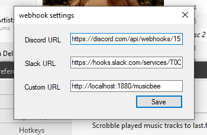
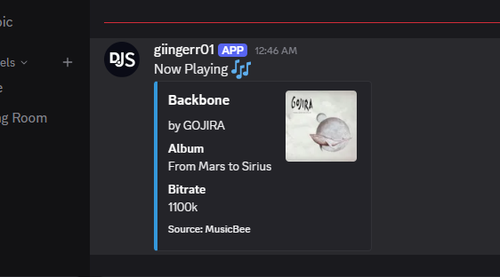
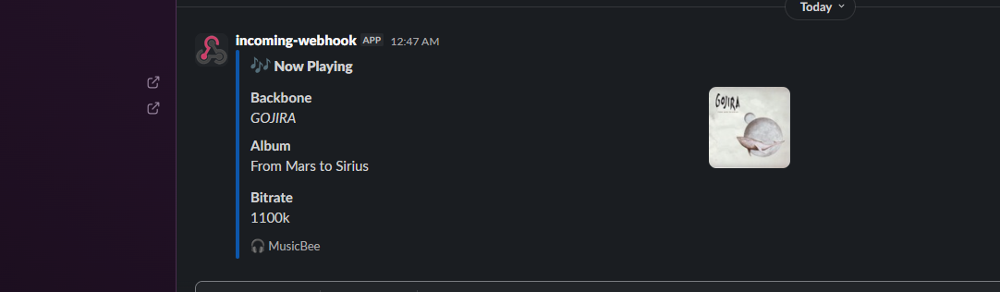
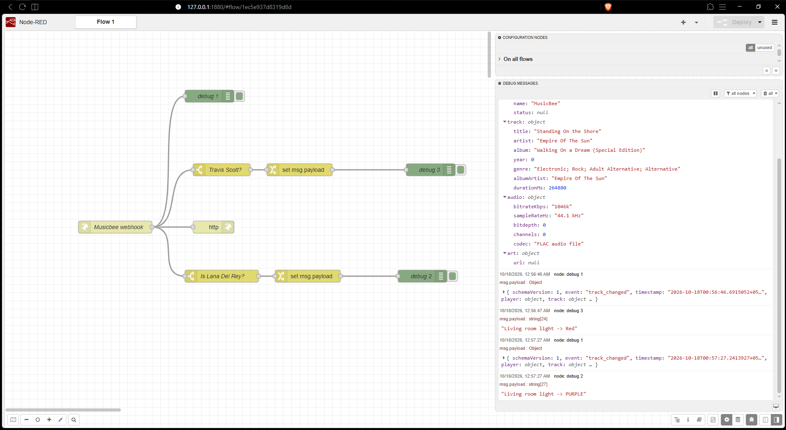

# MB Webhook

A webhook plugin for [MusicBee](https://getmusicbee.com/) that sends **Now Playing** information whenever the current track changes.

MB Webhook supports:

- **Discord** — rich embed notifications
- **Slack** — Block Kit notifications
- **Generic HTTP Webhooks** — structured JSON sent to any compatible HTTP endpoint

The plugin targets **.NET Framework 4.8** and runs on Windows with MusicBee.

## Showcase

<!-- Replace these placeholders with your actual screenshots -->

### Settings



### Discord



### Slack



### Generic Webhook
The example shown here is a mock: it displays red or purple text in the debug panel based on the artist. It does not control physical lights(just and demonstration). To make lights change color, connect the webhook to a service or custom endpoint that handles the automation and communicates with your smart-home devices.



---

## Installation

1. Download the latest release from the [GitHub Releases page](https://github.com/giingerr01/mb_webhook/releases/latest).
2. Extract the downloaded archive.
3. Close MusicBee if it is currently running.
4. Copy `mb_webhook.dll` into MusicBee's `Plugins` folder.

For a standard MusicBee installation, this is commonly:

```text
C:\Program Files (x86)\MusicBee\Plugins\
```

For a portable installation, use the `Plugins` folder next to `MusicBee.exe`.

5. Start MusicBee.
6. Open **Edit → Preferences → Plugins**.
7. Find **Webhook Plugin** and select **Configure**.
8. Add the webhook URLs you want to use and select **Save**.

You only need to configure the services you intend to use.

---

## Discord Setup

MB Webhook uses a Discord **Incoming Webhook**.

To create one:

1. Open the Discord server and choose the channel where Now Playing notifications should appear.
2. Open **Edit Channel → Integrations → Webhooks**.
3. Select **New Webhook**.
4. Choose the destination channel and optionally give the webhook a name.
5. Select **Copy Webhook URL**.
6. Paste the URL into the **Discord URL** field in MB Webhook's settings.
7. Select **Save**.

When the track changes, MB Webhook will send a rich Discord embed containing available track information and artwork.

> [!WARNING]
> Treat webhook URLs like credentials. Anyone with access to the URL may be able to post messages through that webhook. Do not publish or commit webhook URLs.

---

## Slack Setup

MB Webhook uses a Slack **Incoming Webhook**.

To create one:

1. Go to the Slack API website and create or select a Slack app.
2. Open **Incoming Webhooks** for the app.
3. Enable **Activate Incoming Webhooks**.
4. Select **Add New Webhook to Workspace**.
5. Choose the channel where MusicBee notifications should appear.
6. Authorize the app.
7. Copy the generated **Webhook URL**.
8. Paste it into the **Slack URL** field in MB Webhook's settings.
9. Select **Save**.

MB Webhook sends track information using Slack Block Kit formatting with available album artwork.

> [!WARNING]
> Keep the Slack webhook URL private. It grants permission to post through that webhook.

---

## Generic HTTP Webhook

The **Custom URL** option can send MusicBee track-change events to any endpoint that accepts an HTTP `POST` containing JSON.

This makes MB Webhook usable with tools and services such as:

- Node-RED
- n8n
- Home Assistant
- Custom servers and APIs
- Personal dashboards
- Automation workflows

Enter your endpoint in the **Custom URL** field and select **Save**.

For example:

```text
http://localhost:1880/musicbee
```

The receiving endpoint must be reachable from the computer running MusicBee and accept:

```http
POST
Content-Type: application/json
```

### Payload

Generic webhooks use schema version `1`.

Example:

```json
{
  "schemaVersion": 1,
  "event": "track_changed",
  "timestamp": "2026-01-01T12:00:00+00:00",
  "player": {
    "name": "MusicBee",
    "status": null
  },
  "track": {
    "title": "Track title",
    "artist": "Artist name",
    "album": "Album name",
    "year": 2026,
    "genre": "Genre",
    "albumArtist": "Album artist",
    "durationMs": 210000
  },
  "audio": {
    "bitrateKbps": "320",
    "sampleRateHz": "44100",
    "bitdepth": 0,
    "channels": 0,
    "codec": "MP3"
  },
  "art": {
    "url": "https://example.com/artwork.jpg"
  }
}
```

Values depend on the metadata available for the current track. Some properties, including artwork, may be unavailable.

---

## Track Information

Depending on the destination and available MusicBee metadata, MB Webhook can send information including:

- Track title
- Artist
- Album
- Album artist
- Genre and year
- Duration
- Bitrate and audio information
- Album artwork

Artwork is looked up using the iTunes Search API when available.

Notifications are sent when the current track changes. MB Webhook only sends outbound HTTP requests — it does **not** host a webhook server.

---

## Troubleshooting

If a webhook is not working:

1. Check that the webhook URL was copied correctly.
2. Make sure the destination webhook is still active.
3. Save the settings again and change the currently playing track.
4. Check `webhook_plugin_log.log` for HTTP or network errors.

For Generic webhooks, make sure the endpoint is reachable from the MusicBee computer and accepts JSON `POST` requests.

---

## Building from Source

Building the plugin yourself is optional. Most users should install the prebuilt release.

Requirements:

- Windows
- Visual Studio
- **.NET desktop development** workload
- **.NET Framework 4.8 Developer Pack**
- NuGet package restore

Clone the repository and open:

```text
whook_plugin.sln
```

Build the solution using the **Release** configuration.

The compiled plugin can then be found under:

```text
bin\Release\
```

Copy `mb_webhook.dll` into MusicBee's `Plugins` folder.

---

## License

MB Webhook is licensed under the [MIT License](LICENSE).
